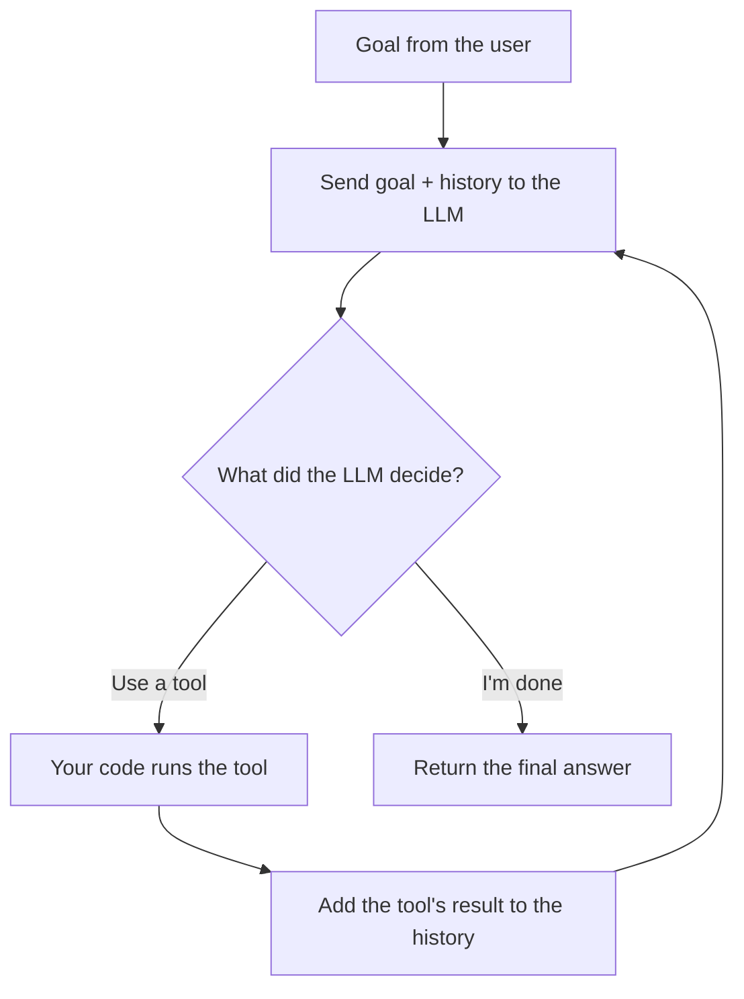

# Lesson 01 · What is an agent?

**Goal:** build the right mental model before writing any code. Everything later
in the course hangs on the ideas in this lesson.

⏱️ ~20 minutes · 🧪 no code, no API key

---

## 1. Start with the LLM

A **large language model (LLM)** like Claude is, at its core, a function:

```
text in  ──▶  [ LLM ]  ──▶  text out
```

Three facts about that function matter for everything that follows:

1. **It's stateless.** It remembers nothing between calls. If you want it to
   "remember" a conversation, you send the whole conversation again every time
   (Lesson 03).
2. **It can only produce output.** It can't read your files, search the web, or
   send an email. It can only *write text saying it would like to*.
3. **It's good at deciding.** Given a goal and some information, it's very good
   at deciding a sensible next step.

An agent combines fact 3 with a way around fact 2.

## 2. From "chatbot" to "agent"

Suppose you ask: *"What's the weather in Paris, and should I bring an umbrella?"*

**A plain LLM call** can only guess. It has no live weather data.

**An agent** works like this:

1. The LLM reads the question and decides: *"I need the weather. I'll call the `get_weather` tool with `city="Paris"`."*
2. **Your code** sees that request, actually calls a weather API, and gets `"14°C, heavy rain"`.
3. Your code sends that result back to the LLM.
4. The LLM decides: *"I have what I need."* It answers: *"It's 14°C with heavy rain, so yes, bring an umbrella."*

That's the whole trick. The LLM **decides**, your code **acts**, and the two pass
messages back and forth **in a loop** until the LLM says it's done.

## 3. The agent loop



Written as pseudocode:

```python
history = [goal]
while True:
    decision = llm(history)            # THINK: the model decides what to do
    if decision.wants_tool:
        result = run(decision.tool)    # ACT: your code does it for real
        history += [decision, result]  # OBSERVE: the result becomes new input
    else:
        return decision.answer         # DONE
```

People call this the **think → act → observe** loop. The research pattern it
comes from is named **ReAct**, short for *Reason + Act*. Almost every agent you'll
meet, from coding agents like Claude Code to research agents to customer-support
bots, is this loop with different tools and different stopping rules.

> 💡 **Key insight:** the LLM never runs anything itself. It only *asks*. Your
> code is always the one that acts, which means your code is also where you add
> safety checks, limits, and human approval.

## 4. Vocabulary

| Term | Meaning |
|---|---|
| **Model** | The LLM itself, e.g. `claude-opus-5-5`. |
| **Message** | One entry in the conversation, with a **role** (`user` or `assistant`) and **content**. |
| **System prompt** | Standing instructions for the model, such as "You are a helpful travel agent". |
| **Token** | The unit models read and write, roughly ¾ of a word. You pay per token. |
| **Context window** | The most tokens the model can read at once (its "working memory"). |
| **Tool** | A function you describe to the model (name, description, input schema) so it can ask you to run it. |
| **Tool call** (`tool_use`) | The model's request: "run tool X with these inputs". |
| **Tool result** (`tool_result`) | What you send back after running the tool. |
| **Stop reason** | Why the model stopped writing: `end_turn` (done), `tool_use` (wants a tool), `max_tokens` (ran out of room), and a few more. |
| **Turn** | One trip around the loop: one model response, plus any tool runs it asked for. |
| **Harness** | All the code around the model: the loop, the tools, the limits, the logging. Building good harnesses is most of the job. |

## 5. Workflows vs. agents

There's a spectrum, and the most important skill is choosing the **simplest**
point on it that does the job.

| | Who decides the steps? | Example |
|---|---|---|
| **Single LLM call** | Nobody. It's one step. | "Summarize this email." |
| **Workflow** | **Your code** runs a fixed sequence of LLM calls. | "Translate → then check the tone → then shorten." |
| **Agent** | **The model** decides which steps, in what order, and when to stop. | "Find out why our test suite is failing and fix it." |

Workflows are predictable, cheap, and easy to debug. Agents are flexible but cost
more, take longer, and fail in less predictable ways. Use an agent only when
**all four** of these are true:

1. **Complexity:** the task has many steps and you can't write them all down in advance.
2. **Value:** the result is worth the extra cost and time.
3. **Viability:** the model is actually capable of the task.
4. **Recoverable errors:** mistakes can be caught and undone, through tests, review, or a rollback.

If any answer is "no", use a workflow or a single call instead. Level 3 of this
course is all about workflows, because experts reach for them more often than
beginners expect.

## 6. What makes agents hard?

Here's a preview of the problems the rest of the course solves:

- **When should the loop stop?** It might never say "done". (Lesson 07)
- **What if a tool fails?** The model should see the error and adapt. (Lesson 06)
- **What if the history gets too long?** It eventually overflows the context window. (Lesson 13)
- **What if the model does something dangerous?** You need guardrails and human approval. (Lessons 07 and 19)
- **How do you know it works?** You need evals, not vibes. (Lesson 18)

---

## ✍️ Exercises

**1. Classify these.** For each, would you use a single call, a workflow, or an agent? Why?

   a. Turn a product description into a tweet.
   b. Every night, pull yesterday's sales numbers, summarize them, and email the summary to the team.
   c. "Our website is slow. Figure out why and propose fixes."
   d. Sort 10,000 support tickets into five categories.
   e. Plan a 5-day trip within a budget, checking real flight and hotel prices.

**2. Draw the loop.** For task (e), write out by hand what the first 4–5 turns of
the loop might look like. Which tool is called, with what input, and what comes back?

**3. Design tools.** For task (c), list 3–5 tools the agent would need. For each,
write a name, a one-sentence description, and its inputs.

<details>
<summary>Suggested answers to Exercise 1</summary>

- **a. Single call.** One input, one output, no decisions.
- **b. Workflow.** The steps are fixed and known: fetch → summarize → email. Code can run them in order.
- **c. Agent.** You don't know the steps in advance. The model has to investigate, look at results, and decide what to check next.
- **d. Single call per ticket**, run many times. (This is "parallelization", a workflow pattern.) No agent needed.
- **e. Agent**, or a workflow if your requirements are rigid. Searches depend on earlier results ("that hotel is too expensive, try another area"), so the model needs to steer.

</details>

---

Next: [Lesson 02 · Your first LLM call](../02-your-first-llm-call/)
